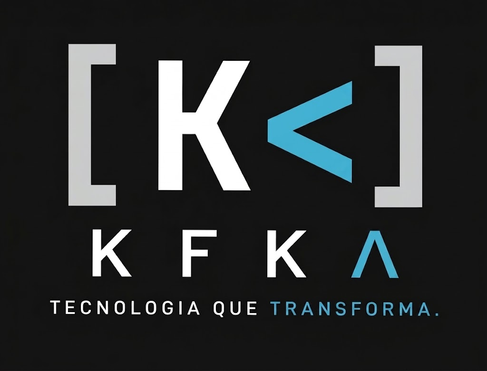

# FECAP - Fundação de Comércio Álvares Penteado

<p align="center">
<a href= "https://www.fecap.br/"></a>
</p>

# KFKA – Plataforma de Acompanhamento Escolar

<p align="center">
  
</p>

## AlphaTech

## Integrantes: <a href="https://www.linkedin.com/in/igor-ara%C3%BAjo-b1719129b/"> Igor Araujo</a>, <a href="https://www.linkedin.com/in/matheus-l-19385b298">Matheus Teixeira</a>, <a href="https://www.linkedin.com/in/daniel-c%C3%A2mara-freitas-796772393/">Daniel Camara</a>, <a href="https://www.linkedin.com/in/enzo-lemos-5333963ab/">Enzo Lemos</a>

## Professores Orientadores:  <a href="https://www.linkedin.com/in/adriano-valente/">Adriano Felix Valente</a>, <a href="https://www.linkedin.com/in/eduardo-savino/">Eduardo Savino Gomes</a>, <a href="https://www.linkedin.com/in/francisco-escobar/">Francisco Escobar</a>, <a href="https://www.linkedin.com/in/jbuesso/">José Carlos Buesso Junior</a>, <a href="https://www.linkedin.com/in/ronaldo-araujo-pinto-3542811a/">Ronaldo Araujo Pinto</a>


## Descrição

A KFKA – Plataforma de Acompanhamento Escolar é uma aplicação web responsiva desenvolvida para auxiliar escolas de Ensino Fundamental no acompanhamento acadêmico dos alunos e na comunicação entre professores, administradores e pais ou responsáveis. O projeto atende a uma demanda da **KFKA**, empresa parceira do Projeto Interdisciplinar.

Os professores registram o acompanhamento bimestral dos alunos, com descrição, média, faltas e tags. Os registros podem ser salvos como rascunho e enviados para revisão do administrador, que pode revisar, alterar, devolver para ajustes ou publicar as informações. Depois da publicação, os pais ou responsáveis consultam os relatórios dos alunos aos quais estão vinculados, geram o PDF e confirmam ciência.

**Fluxo principal:** professor registra → coordenação revisa e publica → família consulta.

## 🌐 Acesse o projeto

O sistema está publicado e pode ser acessado pelo navegador, no computador ou no celular:

| | Endereço |
| --- | --- |
| Site (front-end) | https://kfka-alphatech.netlify.app |
| API (teste de funcionamento) | https://kfka-backend-production.up.railway.app/api/saude |

**Usuários de demonstração** (senha de todos: `Senha@123`):

| Perfil | E-mail |
| --- | --- |
| Coordenação (administrador) | admin@kfka.edu.br |
| Professor | carlos.menezes@kfka.edu.br |
| Responsável | ana.ribeiro@email.com |

**Onde está hospedado:** o front-end (React) está no Netlify; a API (Node.js + Express) e o banco MySQL estão no Railway. As senhas e chaves ficam nas variáveis de ambiente das plataformas, fora do código.

## 🧰 Tecnologias

| Camada | Tecnologias |
| --- | --- |
| Front-end | React, React Router, Vite, HTML5 e CSS3 responsivo |
| Back-end | Node.js, Express, Zod (validação), JWT (login), bcrypt (senhas) |
| Banco de dados | MySQL (tabelas, views e triggers) |
| Design | Figma |
| Estrutura de Dados e POO (Entrega 1) | C# (.NET) e SQLite |

## 🛠 Estrutura de pastas

```text
Projeto38/
├── documentos/
│   ├── Entrega 1/                         # documentos de cada disciplina da Entrega 1
│   └── Entrega 2/
│       ├── BANCO DE DADOS/
│       ├── DESENVOLVIMENTO WEB FULL STACK/
│       ├── DESIGN DE INTERFACE DIGITAL/
│       ├── ESTRUTURA DE DADOS/
│       └── PROGRAMAÇÃO ORIENTADA A OBJETOS/
│
├── imagens/                               # logo e banner do projeto
│
├── src/
│   ├── Entrega 1/
│   │   └── Frontend/                      # telas em HTML, CSS e JavaScript
│   │
│   └── Entrega 2/
│       ├── Backend/kfka-backend/kfka/
│       │   └── backend/                   # API Node.js + Express, scripts do banco e testes
│       └── Frontend/frontend/             # front-end React + Vite
│
└── README.md
```

## 💻 Configuração para Desenvolvimento

**Pré-requisitos:** Node.js 20 ou superior e MySQL (pode ser o do XAMPP).

1. **Banco de dados:** ligue o MySQL (no XAMPP: **Start** no MySQL).
2. **Back-end:** na pasta `src/Entrega 2/Backend/kfka-backend/kfka/backend`, crie o arquivo `.env` (o conteúdo está no [README de Full Stack](documentos/Entrega%202/DESENVOLVIMENTO%20WEB%20FULL%20STACK)) e rode:
   ```bash
   npm install
   npm run db:setup   # cria o banco "kfka" com dados de demonstração (apaga o banco se ele já existir)
   npm run dev        # API em http://localhost:3000
   ```
3. **Front-end:** em outro terminal, na pasta `src/Entrega 2/Frontend/frontend`, rode:
   ```bash
   npm install
   npm run dev        # site em http://localhost:5173
   ```
4. Abra **http://localhost:5173** e entre com um dos usuários de demonstração (senha `Senha@123`): `admin@kfka.edu.br` (coordenação), `carlos.menezes@kfka.edu.br` (professor) ou `ana.ribeiro@email.com` (responsável).

## 📚 Documentação das disciplinas — Entrega 2

| Disciplina | Documentação |
| --- | --- |
| Desenvolvimento Web Full Stack | [README e instruções do sistema](documentos/Entrega%202/DESENVOLVIMENTO%20WEB%20FULL%20STACK) |
| Programação Orientada a Objetos | [README do backend](documentos/Entrega%202/PROGRAM%C3%87%C3%83O%20ORIENTADA%20A%20OBJETOS) |
| Estrutura de Dados | [Mini-relatório e README](documentos/Entrega%202/ESTRUTURA%20DE%20DADOS) |
| Banco de Dados | [Documento das views e README](documentos/Entrega%202/BANCO%20DE%20DADOS) |
| Design de Interface Digital | [Figma, mapa de navegação e Design System](documentos/Entrega%202/DESIGN%20DE%20INTERFACE%20DIGITAL) |

Os documentos da Entrega 1 estão em [documentos/Entrega 1](documentos/Entrega%201).

## 🎓 Referências

As seguintes fontes foram utilizadas como referência para o desenvolvimento do projeto:

1. [FECAP – Fundação de Comércio Álvares Penteado](https://www.fecap.br/)
2. [KFKA Tech](https://kfkatech.com/)
3. Materiais e conteúdos disponibilizados nas aulas da FECAP.
