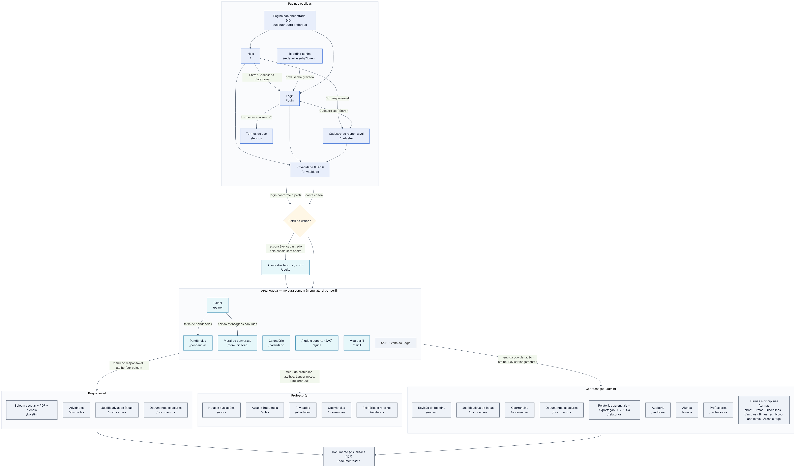

# Design de Interface Digital — Entrega 2 (KFKA / AlphaTech)

- Arquivo no Figma (Design System, protótipo e mapa): https://www.figma.com/design/BTVTE9RkIHtCiyaV0509uG
- Protótipo navegável (modo apresentação): https://www.figma.com/proto/BTVTE9RkIHtCiyaV0509uG?page-id=1%3A5

| Arquivo | Conteúdo |
| --- | --- |
| KFKA_AlphaTech_DesignInterface_Entrega2.pdf / .docx | Documento da entrega: mapa de navegação, protótipo e Design System |
| mapa-navegacao.png / .svg | Mapa de navegação (imagem) |
| mapa-navegacao.mmd | Fonte editável do mapa (Mermaid) |

Páginas do Figma: 1. Design System · 2. Protótipo navegável · 3. Mapa de navegação.
Fluxos para apresentação: público, coordenação, professor(a), responsável e responsável no celular.

## Mapa de navegação

